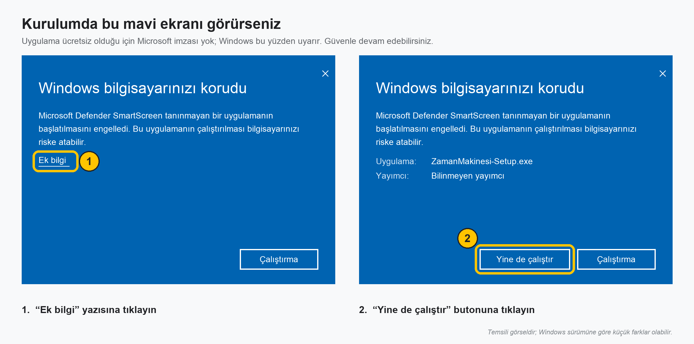

# Zaman Makinesi

Zaman damgası olmayan videolara, sizin girdiğiniz tarihten başlayıp akan bir saat ekler.

## Kurulum (Windows 10 / 11)

1. **[Zaman Makinesi'ni indirin](https://github.com/berkyymn/zaman-makinesi/releases/latest/download/ZamanMakinesi-Setup.exe)**
2. İnen `ZamanMakinesi-Setup.exe` dosyasına çift tıklayın.
   Mavi bir **"Windows bilgisayarınızı korudu"** penceresi çıkarsa **Ek bilgi**'ye, sonra **Yine de çalıştır**'a tıklayın.
   (Uygulama ücretsiz olduğu için imzalı değil; bu uyarı bundan çıkar.)

   
3. **İleri → Kur → Son**. Masaüstüne "Zaman Makinesi" kısayolu gelir.

Yönetici izni gerekmez. Yeni sürüm çıktığında uygulama açılışta haber verir; tek tıkla güncellenir.

## Kullanım

1. Videoları pencereye sürükleyin ya da **Video ekle**'ye tıklayın.
2. Her videonun yanına başlangıç tarihini yazın: `GG.AA.YYYY SS:DD:SS`.
   **Enter** sizi bir sonraki boş tarihe götürür.
   Aynı videodan farklı tarihlerle birden çok çıktı için **+ Tarih ekle**.
3. **Videoları işle**'ye tıklayın. Bitenlerin yanında ✓ çıkar, **Göster** dosyayı açar.

Çıktılar `İndirilenler\Zaman Makinesi` içinde, videoya basılan tarihin ayına göre
klasörlenir: `2026-10 Ekim\deniz_kenari_12_10_2026_14_30_00.mp4`.
Klasörü, aylık düzeni ve açık/koyu temayı **⚙ Ayarlar**'dan değiştirebilirsiniz.

---

## Geliştirme

[uv](https://docs.astral.sh/uv/) gerekir.

```bash
uv run gui.py                 # arayüz
uv run main.py [video.mp4]    # komut satırı: girdi/ klasöründekileri cikti/'ya işler
uv run onizleme.py            # komut satırı: saatin nasıl duracağını tek karede gösterir
QT_QPA_PLATFORM=offscreen uv run python tests/gui_test.py   # arayüz testi
```

Yazı boyutu, konum, renk ve kalite ayarları `main.py`'nin başındaki **AYARLAR** bölümündedir;
hem arayüz hem komut satırı bunları kullanır. Arayüz kuralları için [TASARIM.md](TASARIM.md).

### Yeni sürüm yayınlama

[TASARIM.md](TASARIM.md) içindeki **Sürüm yayınlama kontrol listesi**ni (bölüm 10) eksiksiz uygulayın:
belge, testler, `TUNE_VERSION` kararı, `version.py`, `release.json`, etiket ve derlemenin takibi.
Etiket gönderilince GitHub Actions Windows'ta derler, paketi test eder, kurulum dosyasını ve
`version.json`'u Releases'a yükler. İndirme linki hep aynı kalır ve en son sürümü verir.

Simgeyi değiştirdiyseniz: `uv run icon.py` (`assets/icon.ico`'yu yeniden üretir).
